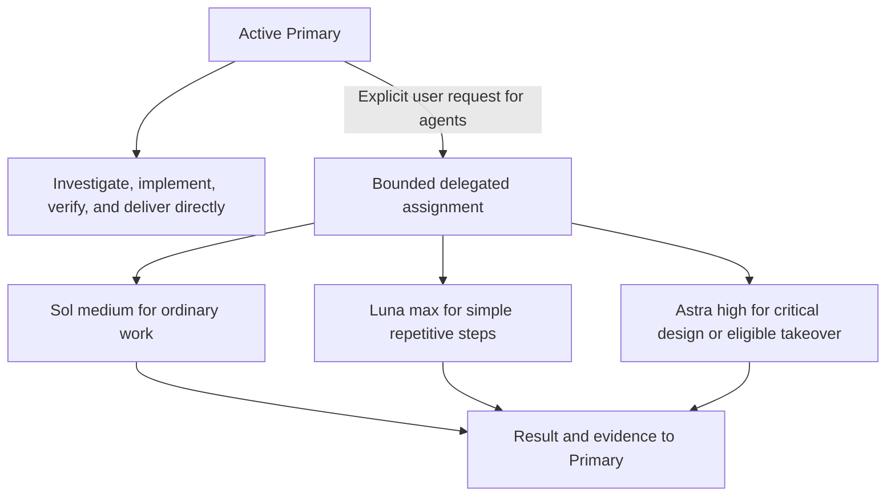

# PigeonStack: Codex Workflow

First, credit and thanks to [Lauren Tan (poteto)](https://github.com/poteto), the original author of [pstack](https://github.com/cursor/plugins/tree/99b609a72323b70204eab407c622f436e858e112/pstack). PigeonStack builds on her work and adapts it for this Codex workflow.

English | [Simplified Chinese](README.zh-CN.md)

[Documentation](https://pigeonai-yang.github.io/pigeonstack/) | [Getting started](https://pigeonai-yang.github.io/pigeonstack/getting-started/) | [FAQ](#faq) | [Issues](https://github.com/PigeonAI-Yang/pigeonstack/issues)

<p align="center">
  <a href="https://github.com/PigeonAI-Yang/pigeonstack/stargazers"></a>
  <a href="https://github.com/PigeonAI-Yang/pigeonstack/forks"></a>
  <a href="https://github.com/PigeonAI-Yang/pigeonstack/watchers"></a>
  <a href="#attribution-and-licenses"></a>
</p>
<p align="center">
  <a href="https://pigeonai-yang.github.io/pigeonstack/"></a>
  <a href="#how-a-task-moves-through-codex"></a>
  <a href="https://github.com/PigeonAI-Yang/pigeonstack/issues"></a>
  <a href="https://github.com/PigeonAI-Yang"></a>
  <a href="https://x.com/KimbomArtist"></a>
  <a href="https://www.xiaohongshu.com/user/profile/689af6b90000000019016082"></a>
</p>

**A Codex setup where the active Primary investigates, implements, and verifies directly. Subagents run only when the user explicitly requests them.**

PigeonStack is PigeonYang's maintained Codex setup: global instructions, a customized version of Lauren Tan's pstack, agent-role definitions, selected host configuration, and a local synchronization script. It keeps the responsibilities and installed instructions reviewable from one source repository.

Agents keep engineering caveats in developer conversations or documentation. They add disclaimers to delivered interfaces or customer-facing backend responses only when the user explicitly requests them. Actual status, errors, and functional limits stay concrete.

The active Primary diagnoses, implements, verifies, and accepts the result directly by default. Subagents require an explicit user request for the current task. Skill selection, complexity, failures, and context pressure do not grant that permission. Within authorized delegation, Sol starts ordinary work at `medium`, Luna at `max` handles only simple repetitive mechanical work, and Astra handles critical design or eligible takeovers. Existing model IDs and efforts remain unchanged.

For explicitly requested multi-agent work, the coordinator assigns a complete outcome to each Main and reviews the finished deliverable. The Main owns diagnosis, implementation, integration, verification, and repair. Nested children require human authorization that covers them. The coordinator routes necessary cross-workstream requests and results, resolves external blockers, and handles ownership conflicts without prescribing every command or approving each internal phase.

This is a set of instructions, a packaged Codex plugin, and deployment tooling. It does not provide an MCP server or a separate autonomous scheduler, and it starts no background timers, resident agents, or remote services. The repository does bundle a bounded `SessionStart` hook; host configuration and trust govern whether it activates.

## SessionStart context hook

The `SessionStart` hook returns only the current region of a saved task record whose session and workspace match the host event. It loads saved task context only; it does not queue or defer messages.

The source also includes `pstack/hooks/task_context.py` for the existing record owner to read and update that same region. Updates use a whole-record SHA-256, preserve bytes outside the region, and archive the complete old body. Keep the current checkpoint concise, with 4–8 KiB as a soft target. The helper does not summarize history or judge semantic completeness, and it does not create or verify a SessionStart binding.

The current body remains limited to 16 KiB. The Windows wrapper reports reader failures through `systemMessage`.

The 2026-10-09 checkpoint maintenance is historical evidence for version `0.15.13+codex.20261009checkpoint`. Local deployment and installed-file checks passed, as did a read/update/archive/readback workflow against a real task record. The workflow reduced the current region from 29,370 to 8,158 bytes. It preserved the goal, permissions, blockers, and history outside the region. See the [historical checkpoint-maintenance evidence](pstack/ADAPTATION.md#current-checkpoint-maintenance-2026-10-09).

The source manifest now records `0.15.32+codex.20261026lean`. Runtime synchronization and new-session behavior are separate observations. During the 2026-10-11 hook verification, the installed version was `0.15.13+codex.20261011copy`. The native reader returned the exact bound current body, including its existing `Pending` qualification. A fresh Desktop chat completed `SessionStart` once with no failures, reported an invalid-index diagnostic, and continued. The native test verified the scratch binding. The Desktop observation verified startup; it did not establish a task binding in `oneirloom`. The cause of the historical Desktop `exit 1` remains unproven. See the [product-copy rules and SessionStart verification](pstack/ADAPTATION.md#product-copy-rules-and-sessionstart-verification-2026-10-11).

The hook does not monitor later business state, intercept agent dispatch, or enforce coordinator reminders. See the [hook contract](pstack/hooks/README.md) and [Codex host adapter](pstack/CODEX.md).

## Start here

PigeonStack keeps global Codex rules, agent roles, configuration, and the adapted pstack plugin in Git, then synchronizes them to a Codex host.

For a safe first check, use [Preview in an isolated target](#preview-in-an-isolated-target) or follow the [getting started guide](https://pigeonai-yang.github.io/pigeonstack/getting-started/).

Not sure which pstack skill fits your task? Ask `/poteto-help`. It reads the bundled guides, recommends a relevant skill, and can provide one example prompt. Asking for help does not start the suggested work. Codex model selection and permissions follow this repository’s GPT configuration.

The verified host is Windows with PowerShell, and the sync script requires Python 3.11 or newer. Real plugin installation also requires a compatible Codex CLI and an existing local marketplace registration for `pstack@personal`.

- Maintain global Codex rules in Git and review them with the source.
- Execute directly by default. Use Sol, Luna, or Astra subagents only when the user explicitly requests delegation.
- Keep the maintained source, runtime files, and versioned plugin cache in sync.

## Why this division of work

Multi-agent work becomes expensive when every child rediscovers the problem, chooses its own repair, or asks another model to repeat the same review. It becomes unreliable when a successful build is treated as proof that the user's workflow works.

PigeonStack gives one Primary responsibility for diagnosis, implementation, verification, decisions, and final acceptance. When explicitly requested, children receive enough context to complete a bounded assignment and return evidence. Independent work can run concurrently, while dependencies and shared resources keep a single owner. The workflow favors a complete, verifiable result with the fewest necessary changes.

### Coordinating multiple workstreams

The following roles and coordination rules apply only within an explicit user request for delegation or an identified team. They do not require agents for ordinary work.

The user's instruction to coordinate the development team covers internal assignments, reports, corrections, and handoffs for that task. The coordinator maintains the return address through handoffs. Mains report substantive results, blockers, and decisions without per-agent approvals or acknowledgment loops. Skipping a reply to another agent does not suppress the user's progress report: the agent explains what it handled and what happens next, rather than returning an empty answer. Related exchanges are combined into one useful update. Version `0.15.13+codex.20261009team` is deployed locally and installed files have been checked. Behavior in new sessions remains unverified. See the [communication changes and verification limits](pstack/ADAPTATION.md#team-communication-and-user-visible-reports-2026-10-09).

Each workstream Main owns a complete assignment through implementation and real verification. Ordinary failures stay in its repair loop. The coordinator does not repeatedly inspect intermediate patches, dictate test commands, or relay each retry. A Main reports its finished outcome or a blocker or decision it cannot resolve within scope; the coordinator reviews final evidence and returns any concrete acceptance gap to the same Main for correction. Human instructions, actual resource conflicts, and material errors requiring immediate intervention still take precedence. User-facing progress remains substantive, with no empty final responses. See [COORDINATOR.md](pstack/COORDINATOR.md); these are instructions, not runtime enforcement.

| Role | Responsibility | Recommended role model and effort |
| --- | --- | --- |
| Primary | Own the goal, diagnosis, implementation, verification, decisions, and final acceptance directly by default. | `gpt-6.1-sol`, `high` recommended default |
| Luna mechanical helper | Simple repetitive tasks with fixed inputs, steps, and directly checkable results. | `gpt-6-luna`, `max` |
| Sol executor | Default ordinary diagnosis, implementation, refactoring, integration, checks, operations, and prose within scope. Separate consultations remain read-only. | `gpt-6.1-sol`, `medium` first |
| Astra Expert | Critical architecture, key contracts, consequential tradeoffs, actual Sol `xhigh` inability, or explicit task-specific selection. Productive owners continue; elapsed time alone does not trigger a handoff. | `gpt-6-astra`, `high` first |

Read-only Astra consultation is available for critical design, a question still unresolved after actual Sol `xhigh` inability, or an explicit task-specific Astra selection. Ordinary bounded consultations start with Sol at `medium` and return a decision and execution brief; they do not implement the application. The Primary dispatches each consultation and child. Takeovers use the general execution role with an explicit model and effort.

These names express this project's model strategy and local configuration. Availability, model IDs, supported effort, and cost depend on your account and Codex client. This repository makes no measured speed, savings, or benchmark-superiority claim.

[MODELS.md](pstack/MODELS.md) recommends `gpt-6.1-sol` at `high` as the Primary role default. The checked-in [configuration](config/workflow.toml) records this checkout's explicit `gpt-6-astra` at `high` selection. These values serve different purposes: changing either file does not switch an already-running session, and a model label does not prove the server's internal model mapping. An explicit task-specific model and effort selection takes precedence over role defaults. A Sol Senior Executor is a separate child that starts at `medium`; the same unresolved problem may advance through Sol `high` and `xhigh`, then Astra `high` and `xhigh`.

## How a task moves through Codex

The Primary reads the relevant evidence, chooses a solution, implements it, and verifies the promised result directly. It keeps its active model and effort. It does not create an explorer, executor, reviewer, or replacement agent unless the user explicitly requests agents for this task.



Authorized agents follow [MODELS.md](pstack/MODELS.md), exclusive ownership, fresh-child lifecycle, and existing evidence-based escalation. That sequence does not grant permission for additional agents. Consultations remain read-only. ComputerUse stays with the Primary, and image work remains serial.

For example, the Primary diagnoses, fixes, and verifies a report-export defect itself. If the user explicitly asks for a Sol subagent, it receives the failure evidence, expected behavior, allowed scope, and checks. A fixed list of approved literal replacements can use Luna only under the same explicit delegation condition.

## What the repository contains

| Source | Purpose |
| --- | --- |
| [AGENTS.md](AGENTS.md) | Global scope, authorization, delegation, scheduling, and acceptance rules. |
| [pstack/CODEX.md](pstack/CODEX.md) | Short host entry that selects task-relevant steps and references. |
| [pstack/MULTI_AGENT.md](pstack/MULTI_AGENT.md) | Assignment, takeover, assessment, and wait procedures for explicitly requested agents. |
| [pstack/HOST_REFERENCE.md](pstack/HOST_REFERENCE.md) | On-demand tool compatibility, saved context, live control, and installation details. |
| [pstack/MODELS.md](pstack/MODELS.md) | Model IDs, reasoning effort, and the spawn contract. |
| [pstack/](pstack/) | The packaged pstack plugin, selected skills, playbooks, upstream material, and local adaptations. |
| [agents/](agents/) | `worker`, `poteto-agent`, and the read-only `astra-advisor` compatibility role for optional consultation. |
| [prompts/](prompts/) | The base instruction file referenced by the deployed configuration. |
| [config/workflow.toml](config/workflow.toml) | The allowlisted configuration keys managed by PigeonStack. |
| [scripts/sync.py](scripts/sync.py) | Read-only drift checks and one-way deployment with backups and readback. |

The authority is explicit. Global `AGENTS.md` owns policy, `CODEX.md` owns host mechanics, and `MODELS.md` owns model IDs and effort. Bundled skills supply procedures for selected steps. Upstream triggers and role defaults do not override the Codex host rules.

Load only the skills and references needed for the current decision. A known local repair does not need a new architecture study. Casual conversation and direct factual answers do not need a playbook. Some retained upstream material still names Cursor tools or optional external integrations; [CODEX.md](pstack/CODEX.md) explains host conversion, and [ADAPTATION.md](pstack/ADAPTATION.md) records the limits. The retained automation examples are dormant reference material.

## Inspect and adapt the source

Clone into a directory you choose:

```powershell
git clone https://github.com/PigeonAI-Yang/pigeonstack.git
Set-Location pigeonstack
```

The currently validated host is Windows with PowerShell. Synchronization requires Python 3.11 or newer. Real plugin installation requires a compatible Codex CLI and an existing local marketplace registration that resolves `pstack@personal`. Multi-agent execution also requires a Codex environment that exposes native child-agent tools and the selected models.

This repository reflects a working personal installation and needs path adaptation on another machine. Before targeting your live Codex home, review these locations:

- `DEFAULT_HOME` in [scripts/sync.py](scripts/sync.py) currently points to `J:/Users/yangda01/.codex`.
- [AGENTS.md](AGENTS.md), [CODEX.md](pstack/CODEX.md), and [poteto-agent.toml](agents/poteto-agent.toml) contain source or runtime paths for the owner's machine.
- [config/workflow.toml](config/workflow.toml) records this checkout's explicit `gpt-6-astra` at `high` selection, agent settings, role files, and plugin enablement. Review the settings you want to adopt before deployment; source-file edits do not switch a running session.

The script does not register a marketplace or provide a zero-configuration installer. A `--codex-home` override does not rewrite every path embedded in instructions. Adapt the maintained source and the existing local marketplace registration before a real installation elsewhere.

### Preview in an isolated target

From the cloned repository, use a new sibling directory to inspect the managed output without targeting your live `.codex` directory:

```powershell
python scripts/sync.py check --codex-home ../pigeonstack-preview-codex --skip-plugin-install
python scripts/sync.py deploy --codex-home ../pigeonstack-preview-codex --skip-plugin-install
python scripts/sync.py check --codex-home ../pigeonstack-preview-codex --skip-plugin-install
```

The first check normally reports drift because the target is empty. Deployment writes managed files and configuration into the preview directory. The final check reports `status: ok` when they match. A nondefault target requires `--skip-plugin-install`, and source and target paths must not overlap.

This preview skips plugin installation and installed-cache checks. It proves the managed copy and configuration merge, not plugin activation or model behavior. The copied instructions retain any host paths you have not adapted.

### Deploy on the configured host

On the owner's current host, preview the scope of the approved change. For instruction files, role files, and pstack updates that preserve the current configuration, use:

```powershell
Set-Location J:/PigeonYang/pigeonstack
python scripts/sync.py check --rules-only
python scripts/sync.py deploy --rules-only
python scripts/sync.py check --rules-only
```

These commands target the configured live Codex home. Deployment needs authorization for the chosen scope. On another machine, complete the path and configuration review above first.

| Scope | Files and configuration managed |
| --- | --- |
| `--agents-only` | Only global `AGENTS.md`. No configuration access or plugin installation. |
| `--rules-only` | Global instruction files, agent roles, and pstack. Skips configuration merging and checks that existing `config.toml` bytes remain unchanged. |
| `--plugin-only` | Only the pstack plugin. Skips global instruction files, roles, and configuration. |
| No scope flag | All managed files and allowlisted configuration, including model and reasoning-effort settings. |

The scope flags are mutually exclusive. Use `--agents-only` for a change confined to the global rules. The no-flag form retains the original full-deployment behavior and requires authorization for its model and configuration changes. A scope that skips configuration can pass while the host intentionally differs from `config/workflow.toml`.

For scopes that contain pstack, the script checks the existing `pstack@personal` registration and installed files. When runtime or installed-cache drift exists, it invokes:

```powershell
codex plugin add pstack@personal --json
```

It then reads back the selected runtime files and compares installed plugin files with the source where applicable. Before a `--rules-only` plugin installation, it also backs up the existing configuration. A configuration change during that operation fails the readback check. The script does not overwrite a concurrent user change to restore the earlier bytes. Installation failures can occur after runtime files were written; inspect the error and backups instead of assuming an automatic rollback.

`check` returns `0` for alignment and `1` for drift. Invalid input or an operational error returns `2`. A successful installation and matching files establish disk state. Verify instruction loading and actual model routing in a new Codex session before claiming the full collaboration behavior works on your host.

## Maintain one source of truth

The owner's deployment follows this direction:

```text
J:/PigeonYang/pigeonstack
    -> J:/Users/yangda01/.codex managed files and local-plugins/pstack
    -> installed pstack plugin cache
```

Edit the source repository. Runtime files and installed caches are deployment copies. The initial import was a snapshot, and synchronization is one-way. If you edit a runtime copy, review and deliberately bring the change back to the source before deployment.

The normal maintenance sequence is:

1. Edit the maintained source and validate the affected files.
2. For plugin changes, follow `CODEX.md` to update the plugin version and any existing marketplace cachebuster.
3. Run `python scripts/sync.py check` with the narrowest applicable scope flag and review the expected drift.
4. Deploy the authorized change with the same scope flag. Changed existing files receive backups under `<codex-home>/backups/pigeonstack/`.
5. Run the same scoped `check`, review the final diff and relevant behavior evidence, and commit when authorized.

An unchanged deployment creates no managed writes or backups. Deployment preserves unrelated parsed configuration values and does not delete extra runtime files. The installed-plugin check does report unexpected extra cache files. Unsupported managed multiline or complex configuration values fail before runtime writes.

The source contains no live credentials, conversation history, or runtime state. Keep local backups, authentication data, session records, and generated caches outside this repository. The configuration merge manages only its explicit allowlist plus the derived `model_instructions_file` path.

## Delivery boundaries

The rules preserve user changes and files of unknown origin. They do not automatically stash, reset, or clean a workspace. A question or diagnosis is read-only by default. Skills do not expand authorization, and publication, deployment, commits, destructive operations, and external messages require authorization for the current task.

Acceptance evidence must support the promised result. A build, mock, command receipt, or child report alone does not prove an actual business workflow succeeded. Use the existing UI, CLI, or business entry point when claiming that behavior. If a service is unavailable or access is denied, report the affected gap and finish independent authorized work.

Prioritize the authorized normal business workflow through existing entry points. When an actual bug occurs or is reported, retain sufficient evidence, diagnose and repair the cause within scope, then rerun the affected real workflow and targeted regression checks. Address the bug when encountered, without waiting for the whole workflow to finish. Block only affected and dependent actions, and continue independent valid work. Report any outcome that an unavailable workflow prevents you from verifying. Targeted regression does not authorize a full test suite.

During normal task work, reuse existing scripts, CLIs, and business entry points. A minimal tool may help with repeated deterministic work only when the need is observed and authorized. Give the responsible agent a way to inspect the real result. Before escalating models, distinguish gaps in tools, feedback, or the environment from reasoning failures. At completion, use evidence already collected to identify recurring mistakes and improve the smallest relevant code, tool, skill, or rule within scope. Record unrelated findings in the existing project record. These habits add no mandatory project scan, report, skill, harness, validation gate, or automatic retrospective.

A validation gate is a mandatory check that must pass before an action can proceed. Add a new gate only for an evidence-confirmed problem or an explicit current requirement. An unverified hypothesis or hypothetical future failure cannot become a new gate or prerequisite. A confirmed bug does not automatically require a gate. If needed, scope the gate to the affected action and boundary, and verify that it catches the failure or enforces the requirement without unnecessarily blocking valid work. Existing required checks, explicit current requirements, and safety, permission, and data-integrity boundaries remain in force before any bug occurs.

These are agent instructions and configuration conventions. They are not runtime enforcement hooks. Keep disk synchronization, installed-plugin verification, instructions read in the current task, and behavior observed in a new session as separate claims.

## Changelog

### 2026-10-26 | `0.15.32+codex.20261026lean`

- Centralize repeated policy and move agent and host details to conditional references.
- Remove automatic extra workflows based on task size, function boundaries, commits, or reviews.
- Preserve the authorization text, explicit delegation condition, model mapping, and role definitions.

### 2026-10-26 | `0.15.32+codex.20261026optin`

- Integrate upstream pstack 0.15.32 at `99b609a72323b70204eab407c622f436e858e112`, including seven new skills.
- Execute directly by default. Subagents, consultations, reviews, and replacements require an explicit user request. Preserve existing GPT models and efforts.
- Source integration only. Deployment and new-session behavior are separate outcomes.

### 2026-10-16 | `0.15.13+codex.20261016solfirst`

- Ordinary development, debugging, integration, verification, operations, and prose default to Sol `medium`. Luna `max` is reserved for simple, highly repetitive mechanical tasks with fixed steps and checkable results.
- Updated global rules, host role mapping, base instructions, worker role, and maintained child defaults together. Consultation results no longer automatically return to Luna for implementation.
- The maintained child default is `gpt-6.1-sol` at `medium`; Primary and Astra settings are preserved during deployment. Configuration and installed-file readback are separate from successful routing observed in a new session.

### 2026-10-11 | `0.15.13+codex.20261011mainownership`

- Coordinator instructions prohibit replacing missing, archived, or unavailable workstream Mains with coordinator-owned implementation children. The coordinator reuses available Mains and prepares missing successor assignments together, while continuing other ready coordination.
- Coordinator children support bounded coordination and final acceptance. Workstream diagnosis, implementation, repair, and child routing stay with the responsible Main. Handoffs preserve existing changes and evidence without restarting completed work.
- Visible chat creation still follows the host's user-request boundary. This update changes instructions; live coordinator behavior has not been tested.

### 2026-10-11 | `0.15.13+codex.20261011noreplay`

- After startup, resume, or compaction, continue from the current checkpoint. Do not replay completed work or treat quoted, revoked historical instructions as current. A later explicit human resume supersedes an earlier Stop within its scope. A genuinely new Stop still takes effect immediately.
- Mains do not message one another. Only the coordinator routes cross-workstream communication. Mains report only verified stage deliverables the next owner can use, completed outcomes, or real exceptions. They do not send fragments or acknowledgment loops. Reuse the task's existing authorization without repeated requests.
- The SessionStart reminder covers startup, resume, and compaction. The 101 existing targeted context-generation checks passed, including a quoted historical Stop with a current resume and a genuinely newer Stop. These checks do not establish live model compliance or message interception. See the [session pickup and coordination rules](pstack/ADAPTATION.md#session-pickup-and-coordination-rules-2026-10-11).

### 2026-10-11 | `0.15.13+codex.20261011productcopy`

- Added the product-copy rule to `AGENTS.md` and `prompts/codex-event-driven-base.md`. Engineering caveats stay in developer conversations or documentation. Agents add disclaimers to delivered interfaces or customer-facing backend responses only at the user's explicit request. They state actual status, errors, and functional limits concretely.
- With installed version `0.15.13+codex.20261011copy`, the native engine completed `SessionStart` in 1,204 ms. It used the observed event session ID to select a temporary scratch binding. It returned the exact current body, including its existing `Pending` qualification. A fresh Desktop chat completed `SessionStart` once (`runs=1`, `failed=0`), emitted an invalid-index diagnostic, and continued.
- The cause of the historical Desktop `exit 1` remains unproven. This update makes no hook-source repair. See the [product-copy rules and SessionStart verification](pstack/ADAPTATION.md#product-copy-rules-and-sessionstart-verification-2026-10-11).

### 2026-10-10 | `0.15.13+codex.20261010acceptance`

- Keep the user's original goal and completion condition separate from scoped Main assignments. After each Main delivery, accept supported parts and continue ready authorized work through its responsible Main before a final answer. If only assigned work is running, use the existing interruptible wait and process its result.
- End only when evidence meets the user's completion condition, the user stops or changes scope, or an outside input or approval the team cannot supply leaves no authorized work ready. Source checks do not prove agent behavior; SessionStart does not intercept turn endings.

### 2026-10-10 | `0.15.13+codex.20261010gates`

- A prerequisite is a gate regardless of its label, including investigation, evidence collection, compatibility review, or acceptance.
- New mandatory work needs a task requirement, an existing mandatory rule, or concrete evidence of a necessary dependency or fault. Uncertainty alone is insufficient.
- Adaptation reuses established capabilities and credible evidence. Coordinators remove unsupported prerequisites without expanding the goal or raising acceptance standards.
- Global and base instructions use the same rule; host and coordinator guidance reference it. Source checks passed; new-session behavior remains unverified.

### 2026-10-10 | `0.15.13+codex.20261010brief`

- Consolidated workstream Main assignments into four fields: goal, observable completion condition, acceptance evidence, and necessary constraints.
- Global rules, coordinator guidance, and base instructions now reference the single template in CODEX.md. Owner and return address remain routing information, not extra prerequisites.
- Internal execution briefs and model routing are unchanged. Source checks passed; behavior in a new session remains unverified.

### 2026-10-10 | `0.15.13+codex.20261010outcome`

- Coordinators remove their own obsolete method restrictions and return unfinished outcomes to the responsible Main in the same turn.
- Missing evidence is tied to acceptance: arrange necessary investigation or collection, and keep optional unknowns from blocking supported work.
- A source gap, exhausted method, or recorded partial handoff alone does not justify ending. Outside dependencies require a specific missing contribution and no remaining ready work.
- Source and configuration checks passed; behavior in a new session remains unverified.

### 2026-10-10 | `0.15.13+codex.20261010progress`

- Thirty minutes is a progress checkpoint, not a task deadline. Agents with substantive progress and a concrete next step continue on the same model, including Astra xhigh.
- Escalation requires evidence that the current agent cannot proceed. External blockers stay with their responsible owner; missing recent output alone does not prove a stall.
- Aligned global rules, model routing, coordinator guidance, base prompts, and managed runtime instructions. The automatic model ceiling remains; it no longer acts as an execution time limit.

### 2026-10-10 | `0.15.13+codex.20261010continuation`

- Mains answer incidental questions in commentary and continue their original task. Running children use native waits; returned results are processed before ending the turn.
- Coordinators assess unfinished Main assignments within 30 minutes. They leave active work alone and restore a confirmed premature ending once per ended turn, using the existing task record and available results.
- Two controlled Desktop tests passed: continuing after an incidental question, and recovering an idle Main through one continuation message. The recovery test used a 15-second assessment deadline, not a full 30-minute interval. These instructions are not runtime enforcement.

### 2026-10-09 | `0.15.13+codex.20261009wait`

- Coordinators awaiting Main reports now use an interruptible 30-minute `clock.sleep`, avoiding repeated two-minute `wait_threads` calls. Ready work and earlier action deadlines take precedence.
- Verified an independent Desktop chat message interrupted a requested 180-second sleep after 41.223 seconds. Mains must send outcome or blocker reports; ending their own chat alone does not notify the coordinator. The 30-minute setting is supported by the tool range, but was not the duration used in this probe.

### 2026-10-09 | `0.15.13+codex.20261009lean`

- Start ready work with the context needed for the next action. Reuse settled decisions and existing evidence instead of demanding exhaustive plans or later-step prerequisites.
- Resolve shared resource access before the operation that needs it; independent work can proceed. Main assignments specify acceptance criteria, and produce completion evidence during execution.
- Cut the three instruction files by about 30%, including roughly half of the coordinator guide. Consolidated repeated preparation and completion instructions. Required permissions, exclusive resource ownership, and final acceptance remain; live agent behavior has not been retested.

### 2026-10-09 | `0.15.13+codex.20261009outcome`

- Coordinators assign complete outcomes. Each Main owns diagnosis, implementation, integration, verification, and repair; coordinators review the finished deliverable rather than approving internal phases.
- Shared operators return results directly to the responsible Main. Routine failures stay in its repair loop; coordinator intervention is reserved for real external blockers, cross-owner conflicts, urgent correctness issues, and human instructions.
- Keep substantive user-facing progress while avoiding acknowledgment loops, unsolicited micro-instructions, and empty final responses. The user's stop-contact instruction remains in force; live team behavior has not been retested for this revision.

### 2026-10-09 | `0.15.13+codex.20261009checkpoint`

- Added a read and update CLI for an existing marked current checkpoint. Updates compare the whole-record SHA-256, preserve all bytes outside the region, archive the complete old body, and verify the replaced record.
- Kept the hook's 16 KiB current-body limit. A 4–8 KiB checkpoint is a soft maintenance target, not a new gate; the helper does not summarize or judge semantic completeness.
- Plugin-only deploy and installed-cache check returned `ok` for version `0.15.13+codex.20261009checkpoint`, with 243 managed files and no drift.
- A live update against a real task record reduced the current checkpoint from 29,370 to 8,158 bytes. The complete previous body was archived and verified; the goal, permissions, and blockers were preserved, and history outside the region stayed unchanged. Natural `SessionStart` behavior remains unverified.
- Owners read the short current checkpoint first and follow only relevant task and evidence references as needed.


### 2026-10-09 | `0.15.13+codex.20261009delivery`

- Each Main's bounded assignment covers ready research, implementation, integration, and verification within the authorized scope. Completing a candidate result, report, or local phase does not require a new dispatch or coordinator permission for the next in-scope step.
- Coordinators give Mains outcome-oriented briefs. Each Main owns judgment and integration, and gives its Luna subtasks concrete execution briefs.
- After a result passes acceptance, continue to the next ready item. If a gap appears, return the specific mismatch to the original Main. A receipt, status update, or forwarding action alone does not prove successful delivery.
- Continue to use accepted evidence for unchanged parts. Recheck only the affected scope when related code changes, a new failure occurs, or a concrete evidence gap appears. The integrating Main reviews the current target content and conflicts. The coordinator avoids repeating a full baseline review.
- A blocker affects only actions that depend on the input, resource, or permission it needs. Record the blocked action, cause, resolver, condition for clearing the blocker, and independent ready work. A missing host fixture does not block independent Python integration. Missing deployment permission does not block independent source integration.
- If handoffs or checks repeat without new delivery evidence, first look for duplicate tasks, unclear ownership, and irrelevant prerequisites, then adjust the work. A healthy long-running task or a justified check does not count as a repeated error. Do not automatically upgrade the model or add timers or mandatory gates. Actual coordination behavior in a new session remains unverified.

### 2026-10-09 | `0.15.13+codex.20261009communication`

- The collaboration rules limit status queries and acknowledgment loops. Ordinary additions wait until the current unit boundary. Corrections to the active action and input needed to clear a blocker are handled immediately. Each Main continues the user-authorized goal through the existing task record. When needed, a Main can send a completion, blocker, or decision report while the coordinator is busy. Desktop `send-now` does not guarantee queueing.
- For `SessionStart`, the Windows probe invocation and error diagnostics improved. The implementation supports 2 MiB record scans and plugin-only deployment that preserves global configuration. The actual coordinator binding and a local static read by the installed plugin were verified. Natural reader injection remains unverified.

## Contributing

Keep changes focused on an observed problem or current requirement. Use the existing source and verification entry points, preserve unrelated work, and describe the evidence for the change. Keep the English and Chinese introductions aligned.

Global instructions, role definitions, and rule updates remain in English. The Chinese README is public documentation. Choose the role by the work required: Sol owns ordinary execution; Luna handles only simple repetitive mechanical work. Separate consultations remain read-only, and takeovers retain their scope through verification. Assign master or system architecture, key interface and data-contract design, and consequential tradeoffs to Astra. Preserve upstream attribution and record adapter changes in [ADAPTATION.md](pstack/ADAPTATION.md).

<a id="faq"></a>

## FAQ

### Is PigeonStack an MCP server, a skill, or an agent?

It is a repository containing a Codex plugin and the instructions and tools that support it. The plugin bundles selected pstack skills and the Codex adapter; global rules, role definitions, configuration, and the synchronization script live alongside it in the repository. It does not run an MCP server or an autonomous scheduler.

### How does PigeonStack differ from pstack?

PigeonStack adapts Lauren Tan's pstack for Codex. It adds Codex-specific global rules, a host adapter, and versioned synchronization for runtime files and the plugin cache. Lauren Tan remains the credited original author. See [Attribution and licenses](#attribution-and-licenses).

### Can I preview PigeonStack without changing my `.codex` directory?

Yes. Follow the isolated-target preview above with a new `--codex-home` path outside your live `.codex` directory and `--skip-plugin-install`. The script writes managed files and merged configuration only to that target. It does not install the plugin in or change your live Codex home, and it cannot prove model behavior.

### Does PigeonStack make Codex faster or cheaper?

No speed or cost benchmarks are published. Cost-efficient collaboration is a design goal, not a measured result. Model access and native child-agent support depend on your Codex host and account.

## Attribution and licenses

PigeonStack is maintained by PigeonYang. The underlying pstack workflows are Lauren Tan's work. This repository adapts pstack `0.15.32` from [the pinned upstream source](https://github.com/cursor/plugins/tree/99b609a72323b70204eab407c622f436e858e112/pstack), commit `99b609a72323b70204eab407c622f436e858e112`. Selected control and cleanup skills come from Cursor Team Kit in that same checkout.

Based on pstack 0.15.32, including `/correct` for recurring agent mistakes, `/benchmark-checklist` for performance evidence, and `/principle-explain-the-number` for explaining measurements. Upstream workflows are adapted to Codex; model selection and escalation follow this project's GPT configuration.

[provenance.json](pstack/provenance.json) records imported files and source hashes. [ADAPTATION.md](pstack/ADAPTATION.md) records the Codex changes and their history. The original notices remain in [pstack/LICENSE](pstack/LICENSE) and [pstack/CURSOR-TEAM-KIT-LICENSE](pstack/CURSOR-TEAM-KIT-LICENSE).

Those MIT notices apply to the respective upstream material. This repository currently has no separate root license granting the same terms to all original PigeonStack content.
